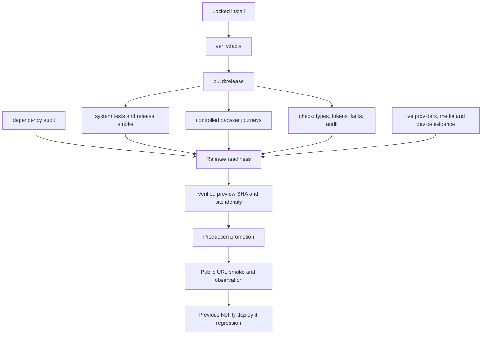

# Deployment-critical code map

Scope: the Next.js application at the release branch root; TypeScript/React,
Node route handlers and Python browser checks. This is a map of the release
path, not an exhaustive catalogue of every UI function.

## Application boundaries

| Entry / signature | Responsibility | Internal dependencies | External dependencies |
| --- | --- | --- | --- |
| `ClassicPage()` in `app/ClassicPage.tsx` | Server composition and corpus loading | `loadContent`, `CASE_QUESTIONS`, section components | React / Next App Router |
| `EvalMatrix({questions}: {questions:string[]})` | Client evaluation display | `content/evals.json`, `Panel`, motion preferences | React state |
| `POST(req: Request): Promise<Response>` in `app/api/agent/route.ts` | Validate, budget, settled response | `ask`, `checkBudget`, `loadContent` | Web Request/Response |
| `GET(req: Request): Promise<Response>` in `app/api/agent/stream/route.ts` | Validate/history bounds, stream JSON SSE, correlation log | `runStream`, `checkBudget`, `loadContent` | ReadableStream, TextEncoder |
| `GET(): Response` in `app/api/health/route.ts` | Report available answer path/configuration | `failoverState`, corpus index, prompt version | Web Response |
| `runStream(question:string, history:Exchange[]=[]): AsyncGenerator<StreamEvent>` in `lib/agent/stream.ts` | Cache, policy, retrieval, generation and explicit degradation | prewarm, policy, retrieval, grounding, provider helpers | LangChain/provider clients via model module |
| `invokeWithFailover(messages:{role:string;content:string}[], deadline=Infinity): Promise<{text:string;provider:ProviderName;usage:{in:number;out:number}\|null}>` in `lib/agent/model.ts` | Bounded provider attempts and result metadata | provider registry, cooldown, deadline helpers | LangChain OpenAI-compatible clients |
| `denseFromNeon(table:string, query:number[], limit:number, timeoutMs:number): Promise<Map<number,number>\|null>` in `lib/agent/store.ts` | Optional bounded vector lookup | table identity from index | Neon serverless |
| `corpusHash(): string` in `lib/content.ts` | Fingerprint loaded section titles/bodies | `loadContent` | Node crypto |
| `check(path, validate): Promise<void>` in `scripts/release-smoke.mjs` | Bounded HTTP delivery check and aggregate failure exit | release URL, per-route assertions | Node fetch/assert/fs |

Return types shown for handlers are their inferred public contracts. Defaults
above are those in the implementation. Node filesystem code must stay on the
server; serializable questions cross to EvalMatrix as props.

## Deployment dependencies

`package-lock.json` pins the JavaScript tree; `release/requirements.txt` pins the
existing browser/statistics tooling. Next.js bundles the server and client
separately. `@netlify/plugin-nextjs` adapts routes, SSR and assets to Netlify.
`content/` is the factual source; committed index, calibration, caches and media
must match the candidate. Do not run embedding regeneration during promotion.

Health is not a provider synthetic, a fixture stream is not an LLM quality test,
and a successful build is not a successful upload. Those boundaries remain
separate gates in the release contract.
