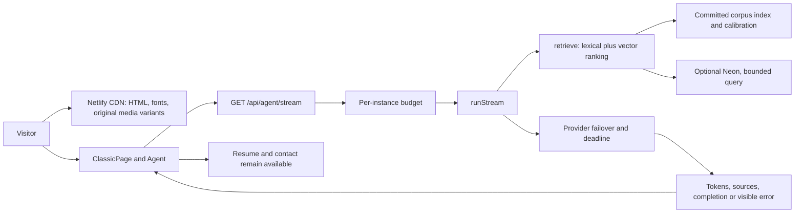

# Production release contract

Date: 2026-10-25. Status: release candidate work; production is not certified.

Current scope: deployment preparation and delivery. UI/agent product repairs
remain with their existing sessions. See [verification](verification.md) and
[code map](c4-code.md).

## Goal and release boundary

Deliver the existing portfolio with full-resolution source media, smooth motion,
responsive interactions, grounded answers, visible degradation and a reversible
release. An attractive page is insufficient if its build, evidence or failure
paths cannot be reproduced. Zero errors and zero network latency are not
promises; the following acceptance criteria are the contract.

Start commit: `0c030da`, from `main-2026-10-25`. Isolated branch:
`codex/production-readiness`. That commit merges the UX and reconciliation
snapshots and the clean shipping branch. The old parent repository is a different
application. Do not deploy from it.

The active v2 checkout has additional uncommitted Agent, Hero, event, grounding,
telemetry and configuration changes. These are not silently included. Before
release, reconcile their final commits, rerun every affected gate, and record the
final SHA. Never reset, stash or commit another session's working tree. The
EvalMatrix server/client boundary repair was independently present in that
checkout and has been applied here after reproducing the production build error.

## Architecture decision

Keep one Next.js app and the existing Netlify deployment, with static assets
served by its CDN and server routes handling agent requests. Keep the bundled
retrieval index as the fallback for optional Neon access. Do not introduce a
new Python service, Kubernetes, Redis or paid host just for deployment.

| Option | Correctness | Failure isolation | Maintenance | Reversibility |
| --- | --- | --- | --- | --- |
| Existing single app plus strict gates | High after validation | Static page independent of agent | Low | One deploy rollback |
| Split frontend, agent and workers now | More contracts to verify | More network/cold-start failure points | High | Multiple coordinated rollbacks |

Chosen: single app. Revisit only after measured capacity or availability limits.
Netlify supports Next.js App Router and streaming; preview verification is still
required for this exact app and adapter version.
Source: https://docs.netlify.com/build/frameworks/framework-setup-guides/nextjs/overview/

## Verified deployment wiring

`netlify status --json` and a filtered `getSite` read confirmed the target on
2026-10-25: site `kushal-portfolio-223`, ID
`5a02ef1d-75c0-4f11-a6af-b4fe2df63e73`. Its Git integration points to
`Kushal9889/kushal-portfolio`, branch `main`, not the v2 repository. The published
ready deploy ID was `6a8955c8330442514aca1e1b`; it reported no commit reference.
Re-read these values before publishing or rolling back; do not treat this
snapshot as permanently current.

A v2 PR therefore does not establish a production deploy path. Cut over the Git
integration only after required checks and publication controls are configured,
or publish the verified candidate explicitly to the verified site ID. Do not
push the old repository merely to trigger Netlify. Preview context compiles the
committed candidate with facts/unit checks; production additionally runs the
blocking repository checks. Preview availability is not production approval.

## Numeric acceptance criteria

All values below are targets, not claims of achieved performance. Retain raw
reports, sample counts, commit, build ID, browser, device, network profile and
UTC timestamp. Missing evidence is pending, never passing. A changed candidate
invalidates earlier affected results.

| Surface | Required target | Proof / release behavior |
| --- | --- | --- |
| Clean install/build | 100% success on Node 22 + locked npm dependencies | `npm ci`, `build:release`; no API calls to regenerate artifacts |
| Server packaging | No CDN media/local reports in function traces; trace union <=200 MiB, runtime facts present | `verify-server-bundle.mjs` after every release build |
| Source/data drift | 0 corpus mismatches; 0 unreviewed generated changes | `verify:facts`, git diff of content/index/media |
| Functional correctness | 0 failed mandatory tests; every skip explained | `check`, unit/integration/system and gate self-tests |
| Security | 0 high/critical production dependency findings | `npm audit --omit=dev --audit-level=high`; no blanket exceptions |
| Browser journeys | 100% completion across 390/1440, both motion modes | `ui-journeys.py`; Ask, stop, retry, resume, copy, navigation |
| Responsive controls | 0 horizontal overflow; primary targets >=44x44 CSS px | Existing journey suite at 320 through 1920 px |
| Accessibility | 0 blocking axe findings; keyboard journeys succeed | `ui-axe.py`, journey suite; video contrast measured separately |
| Visual integrity | 0 missing images, blank film transitions, unreadable overlays | Original assets retained; film contrast/layout + screenshot review |
| Loading | LCP <=2.5 s, CLS <=0.1, INP <=200 ms at field p75 | Field targets; repeated lab measurements are separate evidence |
| Interaction acknowledgement | p95 <=100 ms from action to visible busy/stop state | At least 20 browser actions per device profile |
| Motion | Mean dropped frames <=0.5%; no blank handover; no unintended motion in reduced mode | `bench:film` 5 repeats on quiet real hardware; 390/1440 + retina |
| Agent latency | Cached answer p95 <=500 ms; fresh first text p95 <=2.5 s; completion p95 <=8 s | At least 30 uncached/live samples, cold and warm reported separately |
| Agent quality | precision@5 >=0.80, recall@5 >=0.85, nDCG@5 >=0.85; groundedness >=0.95 | Locked held-out suite, full provider run; null metrics cannot certify quality |
| Safety/degradation | Injection block =100%; 0 unprompted work-auth leaks; fault p95 <=8 s | Existing seven-fault matrix; verify faults actually exercised configured providers |
| Capacity | 20 concurrent browsers; 5 concurrent uncached agent requests for 60 s, 0 unhandled errors | Preview load run with explicit quota budget; no large production stress test |
| Availability | Page 99.9% monthly; successful or explicitly degraded agent 99.5% | Proposed operating SLO, needs actual monitoring; degradation counted separately |
| Recovery | Restore previous known-good deploy <=5 min | Preview rollback drill + recheck resume, assets and streaming |

Core Web Vitals source: https://web.dev/articles/defining-core-web-vitals-thresholds
A low-traffic site may lack enough field data. Report that limitation rather than
substituting desktop lab results for field INP or mobile GPU proof.

## Build and regression gates

`build:release` compiles committed artifacts. `build` remains an authoring command
that can rebuild embeddings/cache/assets. CI and Netlify must use the release
command, so provider availability cannot silently change the shipped corpus.

1. Install lockfile on Node 22; run `test:gates` and fact verification.
2. Build once with `build:release`; run `check`, `npm test`, system tests against
   that build. `check` follows the build because audit reads generated CSS.
3. Browser job exercises controlled UI fixtures against the production server.
   It proves client behavior, not model quality or live network streaming.
4. Separate security and link jobs fail visibly; no `continue-on-error`.
5. Scheduled/manual live evals require provider credentials; no key means failure,
   not a skipped green quality claim. Keep artifact mutation out of the release.
6. Run the real-hardware film benchmark separately from CPU-heavy builds. Do not
   weaken its ceiling because the host was busy. Record invalid runs and repeat.
7. Required GitHub branch checks and Netlify production publication policy must
   be verified in account settings. A workflow file alone cannot enforce these.

Gate repairs in this branch remove filtered shell output that lost exit codes,
remove an allowance for 13 failed checks, and reject failed film subprocesses
before reading reports. Tests inject failing processes that print `PASS` to
prove the wrappers still fail.

## Runtime contracts and observability

- `POST /api/agent`: JSON `{question:string}`, invalid input 400; legacy settled
  response may return route `error` at HTTP 200. Monitor the semantic result,
  not just status. It currently caps input at 500 characters.
- `GET /api/agent/stream?q=...&h=...`: SSE frames containing JSON `type`; input
  capped at 2000 characters and last two history exchanges bounded. Completion
  ends in `done`, failure in `error`; record first text separately from first
  headers/route frame. Query strings contain user input: redact them in access
  logs and do not enter sensitive information during smoke checks.
- `/api/health`: configuration/availability-of-a-path check, **not** proof that
  external providers are healthy. A bundled fallback can keep it HTTP 200.
- Correlate stream request IDs, completion latency, provider, degraded flag and
  failed steps. Track client errors, aborted streams, failed media requests and
  resume delivery separately. Do not log prompts, keys or full histories.
- Alert on two consecutive synthetic failures, any sustained 5xx increase, or
  agent degraded rate >5% over >=20 requests. Alert delivery and retention must
  be configured and tested before calling observability complete.
- Per-IP budget is local to each server instance and trusts forwarded headers.
  It is **not** a global spending cap. Enforce hard provider-side spend limits;
  assess trusted proxy IP extraction and distributed limiting before paid scale.
- Cancellation currently requires a dedicated disconnect test: a closed browser
  must not continue consuming provider output without a bound. Deadline races
  alone do not prove underlying requests were cancelled.

## Rollout and rollback

1. Freeze a candidate commit after reconciling active writers. Inventory required
   environment-variable names without printing their values. Never copy keys
   into Git or chat. Supply credentials through the deployment secret manager.
2. Resolve every failing blocking gate and skipped critical requirement. Retain
   source media hashes; optimize loading/decoding rather than replacing originals
   with low-quality assets or disabling requested motion to game the benchmark.
3. Create PR and obtain a Netlify preview for that exact SHA. Verify the account's
   site identity: `kushal-portfolio-223.netlify.app` is the recorded resume URL,
   but verify it against the current resume and Netlify account before promotion.
4. On preview: HTTP, SSE progressively arriving (not buffered), cold-start,
   denied microphone, provider exhaustion, mobile Safari/Chrome and physical
   device film checks. Test the resume PDF itself, canonical URL and share card.
5. Record previous production deploy ID; perform a preview rollback/re-publish
   drill. Confirm publication controls will not bypass failing CI.
6. Promote the validated artifact, avoiding an unverified rebuild. Verify from
   the public resume URL and a second network; inspect logs and media delivery.
7. Observe for 30 minutes. Roll back immediately for missing resume/contact,
   repeated stream failure, broken assets or severe motion regression. Restore
   the old deploy first, investigate second. Keep old media available to open tabs.

Start on existing free-tier infrastructure. No new paid service is required by
this plan. Free-tier quota and cold starts are constraints to measure, not SLA
promises. Authorize spend only after measured need and explicit cost limits.

## Work sequence and exit conditions

- A: baseline and gate repair — reproducible build, evidence, fail-closed wrappers.
- B: security and correctness — patched dependency tree, UI/backend failures
  repaired, no skipped critical behavior, concurrent changes reconciled.
- C: media and latency — five-run film evidence, real mobile proof, cold/warm live
  agent metrics and bounded load; preserve visual fidelity.
- D: deployment operations — preview parity, secrets/configuration verified,
  required checks configured, monitoring/rollback drill, production promotion.

Do not mark the goal complete when only A is complete. Each later stage is a
release requirement; the PR can remain draft until its evidence is green.
